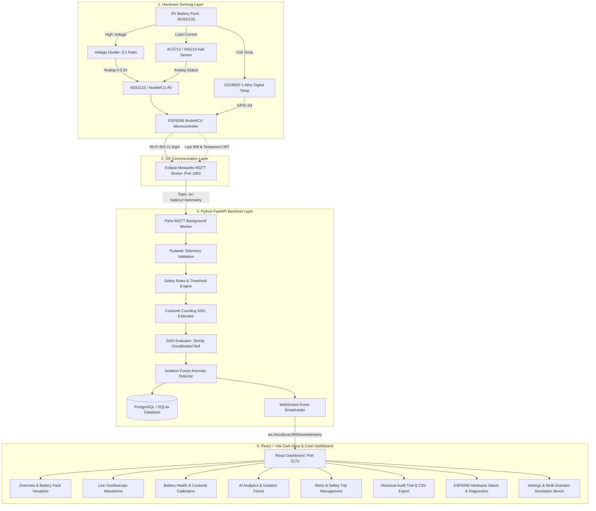

# EDGE AI-BASED PREDICTIVE BATTERY SAFETY AND HEALTH MONITORING SYSTEM FOR ELECTRIC VEHICLES USING IoT

[](https://python.org)
[](https://fastapi.tiangolo.com)
[](https://react.dev)
[](https://vitejs.dev)
[](https://tailwindcss.com)
[](https://mosquitto.org)
[](https://scikit-learn.org)

An end-to-end industrial-grade Internet of Things (IoT) and Edge Artificial Intelligence (AI) telemetry monitoring system for Electric Vehicle (EV) battery packs. The system streams real-time physical sensor data (Voltage, Current, Temperature) from an **ESP8266 NodeMCU**, executes edge safety rules and **Coulomb Counting State of Charge (SOC)** tracking, runs **Scikit-Learn Isolation Forest Anomaly Detection**, persists historical telemetry in **PostgreSQL / SQLite**, and broadcasts live high-frequency telemetry via **WebSockets** to a **React + Vite Dark Navy & Cyan Dashboard**.

---

## 📑 Table of Contents
1. [System Architecture & Data Flow](#1-system-architecture--data-flow)
2. [Project Folder Structure](#2-project-folder-structure)
3. [Hardware Wiring & Sensor Pinout](#3-hardware-wiring--sensor-pinout)
4. [Sensor Calibration & Mathematical Specifications](#4-sensor-calibration--mathematical-specifications)
5. [Prerequisites & Software Installation](#5-prerequisites--software-installation)
6. [Starting Mosquitto MQTT Broker & Database](#6-starting-mosquitto-mqtt-broker--database)
7. [Starting the Python Backend](#7-starting-the-python-backend)
8. [Starting the React Frontend Dashboard](#8-starting-the-react-frontend-dashboard)
9. [Flashing the ESP8266 NodeMCU Firmware](#9-flashing-the-esp8266-nodemcu-firmware)
10. [Testing With Hardware & Simulation Bench](#10-testing-with-hardware--simulation-bench)
11. [State of Charge (SOC) & State of Health (SOH) Implementation](#11-state-of-charge-soc--state-of-health-soh-implementation)
12. [AI Anomaly Detection Pipeline](#12-ai-anomaly-detection-pipeline)
13. [Troubleshooting Guide](#13-troubleshooting-guide)
14. [College Project Viva & Demonstration Guide](#14-college-project-viva--demonstration-guide)

---

## 1. System Architecture & Data Flow



---

## 2. Project Folder Structure

```
c:/MINI PRO/
├── backend/
│   ├── app/
│   │   ├── __init__.py
│   │   ├── main.py                     # FastAPI entrypoint, lifespan, CORS, WebSockets
│   │   ├── config.py                   # Pydantic Settings configuration & battery limits
│   │   ├── api/                        # REST API routing modules
│   │   │   ├── __init__.py
│   │   │   ├── routes_telemetry.py     # Ingestion & historical pagination endpoints
│   │   │   ├── routes_devices.py       # Device status, latest snapshot, SOC calibration
│   │   │   ├── routes_alerts.py        # Active alert trips, acknowledge & resolve
│   │   │   ├── routes_predictions.py   # AI anomaly scores and inferences
│   │   │   ├── routes_simulation.py    # Multi-scenario simulator controls
│   │   │   └── routes_model.py         # Isolation Forest training trigger & SOH status
│   │   ├── schemas/                    # Pydantic V2 validation schemas
│   │   ├── models/                     # SQLAlchemy ORM models (telemetry, alerts, etc.)
│   │   ├── database/                   # Database engine, SessionLocal, and init_db seeds
│   │   ├── mqtt/                       # Paho-MQTT subscriber with LWT & QoS 1
│   │   ├── services/                   # Business logic (Safety, Coulomb SOC, SOH, Watchdog)
│   │   ├── ai/                         # IsolationForest anomaly detector & training pipeline
│   │   └── tests/                      # Automated Pytest suite (12 passing tests)
│   ├── requirements.txt                # Python backend dependencies
│   └── .env                            # Backend local environment configuration
├── frontend/
│   ├── src/
│   │   ├── components/                 # Reusable UI widgets
│   │   │   ├── Header.tsx              # Top navbar with live connectivity badges
│   │   │   ├── Sidebar.tsx             # 8-tab navigation sidebar
│   │   │   ├── MetricCard.tsx          # High-contrast metric cards with status glows
│   │   │   └── BatteryPackVisualizer.tsx # Multi-cell battery visualizer with dynamic flow
│   │   ├── pages/                      # 8 dedicated application views
│   │   │   ├── OverviewPage.tsx
│   │   │   ├── LiveMonitoringPage.tsx
│   │   │   ├── BatteryHealthPage.tsx
│   │   │   ├── AIAnalyticsPage.tsx
│   │   │   ├── AlertsEventsPage.tsx
│   │   │   ├── HistoricalDataPage.tsx
│   │   │   ├── DeviceStatusPage.tsx
│   │   │   └── SettingsPage.tsx
│   │   ├── context/                    # BatteryContext with WebSocket auto-reconnect
│   │   ├── services/api.ts             # Central API client
│   │   ├── types/index.ts              # TypeScript interface declarations
│   │   ├── App.tsx                     # Main layout & router
│   │   └── index.css                   # Tailwind directives & glassmorphic styling
│   ├── package.json                    # Node dependencies (React, Vite, Recharts, Lucide)
│   ├── tailwind.config.js              # Dark navy and cyan theme tokens
│   └── vite.config.ts                  # Vite development and bundle configuration
├── firmware/
│   └── esp8266_ev_battery_monitor/
│       ├── esp8266_ev_battery_monitor.ino # Arduino sketch with non-blocking MQTT
│       └── config.h                    # Hardware pin mapping, WiFi, calibration offsets
├── docker/
│   └── mosquitto/
│       └── mosquitto.conf              # Mosquitto MQTT broker configuration
├── scripts/
│   └── mqtt_test_publisher.py          # Standalone hardware simulator script
├── docker-compose.yml                  # One-click Mosquitto & PostgreSQL Docker services
├── .env.example                        # Global environment variables template
├── .gitignore                          # Clean repository ignore patterns
└── README.md                           # Master project manual
```

---

## 3. Hardware Wiring & Sensor Pinout

### ⚠️ Critical ESP8266 ADC Input Limitations:
1. **The bare ESP8266 silicon has ONLY ONE analog input pin (A0)**, which accepts a maximum of **1.0 V**.
2. **NodeMCU breakout boards include an onboard 220kΩ / 100kΩ voltage divider**, scaling the external pin limit to **3.3 V**.
3. **NEVER connect battery voltage directly to pin A0**; doing so will permanently destroy the ESP8266!
4. If you need to read **both** analog voltage and analog current (e.g. ACS712), you must use an external I2C ADC module like the **ADS1115 (16-bit 4-channel)** OR use digital I2C/1-Wire sensors (INA219 + DS18B20).

### Recommended Wiring Pinout Table (ADS1115 Topology):

| Module / Sensor | Sensor Pin | ESP8266 NodeMCU Pin | Function / Notes |
| :--- | :--- | :--- | :--- |
| **ADS1115 16-Bit ADC** | VDD | 3V3 / Vin (5V) | Power supply |
| | GND | GND | Common ground with battery |
| | SCL | **D1 (GPIO 5)** | I2C Clock line |
| | SDA | **D2 (GPIO 4)** | I2C Data line |
| | ADDR | GND | Sets I2C address to `0x48` |
| | A0 | Voltage Divider Signal | Measures scaled pack voltage |
| | A1 | ACS712 OUT | Measures Hall-effect current |
| **Voltage Divider Module** | VCC (+) | Battery Pack Positive (+) | Max voltage e.g. 12.6V or 25V |
| | GND (-) | Battery Pack Negative (-) | Common system ground |
| | Signal (S) | ADS1115 A0 (or NodeMCU A0) | Scaled analog voltage output |
| **ACS712 Current Sensor** | VCC | 5V (Vin pin) | ACS712 requires 5.0V for Vcc/2 |
| | GND | GND | Common ground |
| | OUT | ADS1115 A1 | Analog current output (2.5V zero) |
| | IP+ / IP- | In-Series with EV Battery Load | Inline load current path |
| **DS18B20 Temperature** | VDD | 3V3 | Digital temperature power |
| | GND | GND | Ground |
| | DQ (Data) | **D4 (GPIO 2)** | 1-Wire bus with **4.7kΩ pull-up to 3.3V** |

---

## 4. Sensor Calibration & Mathematical Specifications

### 1. Voltage Divider Scaling Calculation
For a standard resistive divider with $R_1 = 30\text{ k}\Omega$ and $R_2 = 7.5\text{ k}\Omega$:
$$\text{Division Ratio} = \frac{R_1 + R_2}{R_2} = \frac{30 + 7.5}{7.5} = 5.0$$
$$\text{Pack Voltage } V_{\text{pack}} = V_{\text{ADC}} \times 5.0$$

On a NodeMCU board with 10-bit built-in ADC (0 to 1023):
$$V_{\text{ADC}} = \left(\frac{\text{rawADC}}{1023.0}\right) \times 3.3\text{ V}$$
$$V_{\text{pack}} = \text{rawADC} \times \left(\frac{3.3}{1023.0} \times 5.0\right) = \text{rawADC} \times 0.016129$$

> **Calibration Step**: Measure the actual pack voltage with a calibrated digital multimeter ($V_{\text{actual}}$). If the display shows $V_{\text{measured}}$, update `VOLTAGE_CALIBRATION_FACTOR` in [config.h](file:///c:/MINI%20PRO/firmware/esp8266_ev_battery_monitor/config.h):
> $$\text{New Factor} = \text{Old Factor} \times \frac{V_{\text{actual}}}{V_{\text{measured}}}$$

### 2. ACS712 Current Sensor Calibration
The ACS712 outputs $V_{CC} / 2 = 2.50\text{ V}$ when zero current is flowing ($I = 0\text{ A}$).
Current in Amperes:
$$I = \frac{V_{\text{sensor}} - V_{\text{zero\_offset}}}{\text{Sensitivity (V/A)}}$$
- **ACS712-05B**: Sensitivity = $0.185\text{ V/A}$ (185 mV/A)
- **ACS712-20A**: Sensitivity = $0.100\text{ V/A}$ (100 mV/A)
- **ACS712-30A**: Sensitivity = $0.066\text{ V/A}$ (66 mV/A)

The firmware includes an automatic zero-point sampling function in `calibrateSensors()` executed on boot while the battery is resting.

### 3. Noise Filtering
To eliminate high-frequency switching ripple generated by EV motor controllers or inverter switching, the firmware takes a **10-sample moving average** for every telemetry publish cycle.

---

## 5. Prerequisites & Software Installation

### Runtime Requirements
- **Node.js**: v18+ or v24 LTS (Installed at `C:\Users\admin\AppData\Local\Microsoft\WinGet\Packages\OpenJS.NodeJS.LTS_...`)
- **Python**: v3.11+ or v3.12 (Installed via Microsoft Store / WinGet)
- **Arduino IDE**: v2.x (with ESP8266 core installed)
- **Docker & Docker Compose** (Optional: for containerized Mosquitto & PostgreSQL)

### 1. Install Backend Dependencies
In PowerShell:
```powershell
cd "c:\MINI PRO\backend"
python -m venv venv
.\venv\Scripts\Activate.ps1
pip install -r requirements.txt
```

### 2. Install Frontend Dependencies
In a second PowerShell terminal:
```powershell
cd "c:\MINI PRO\frontend"
npm install
```

---

## 6. Starting Mosquitto MQTT Broker & Database

### Option A: Using Docker Compose (Easiest)
If Docker Desktop is installed:
```powershell
cd "c:\MINI PRO"
docker compose up -d
```
This instantly starts:
- **Mosquitto MQTT Broker** on port `1883` (and WebSocket port `9001`)
- **PostgreSQL 16** on port `5432`

### Option B: Local Execution (Zero-Setup Default)
The application is preconfigured with **SQLite out-of-the-box** (`ev_battery.db`). You do **not** need to install PostgreSQL to test the application locally!
If Mosquitto is installed locally as a Windows service:
```powershell
net start mosquitto
```
*(If you do not have Mosquitto installed, the backend and frontend run seamlessly using the built-in HTTP REST fallback and interactive simulator).*

---

## 7. Starting the Python Backend

In PowerShell:
```powershell
cd "c:\MINI PRO\backend"
.\venv\Scripts\Activate.ps1
python -m uvicorn app.main:app --host 0.0.0.0 --port 8000 --reload
```

Verify backend health by opening in your browser:
- Health Check: `http://localhost:8000/api/health`
- Interactive Swagger API Docs: `http://localhost:8000/docs`
- Device Snapshot: `http://localhost:8000/api/devices/ev-battery-001/latest`

---

## 8. Starting the React Frontend Dashboard

In PowerShell:
```powershell
cd "c:\MINI PRO\frontend"
npm run dev -- --host 0.0.0.0 --port 5173
```

Open your browser and navigate to:
**`http://localhost:5173/`**

---

## 9. Flashing the ESP8266 NodeMCU Firmware

1. Launch **Arduino IDE**.
2. Open File -> Preferences, and add this URL to **Additional Boards Manager URLs**:
   ```
   http://arduino.esp8266.com/stable/package_esp8266com_index.json
   ```
3. Go to **Tools -> Board -> Boards Manager**, search for `esp8266`, and install **esp8266 by ESP8266 Community**.
4. Install the required libraries in **Tools -> Manage Libraries**:
   - `PubSubClient` by Nick O'Leary
   - `ArduinoJson` by Benoit Blanchon (v6 or v7)
   - `OneWire` by Paul Stoffregen
   - `DallasTemperature` by Miles Burton
   - `Adafruit ADS1X15` (if using ADS1115 ADC)
5. Open the firmware sketch:
   `c:\MINI PRO\firmware\esp8266_ev_battery_monitor\esp8266_ev_battery_monitor.ino`
6. Open `config.h` in the IDE tabs and modify:
   - `WIFI_SSID`: Your local Wi-Fi name
   - `WIFI_PASSWORD`: Your local Wi-Fi password
   - `MQTT_BROKER_HOST`: Your PC's local Wi-Fi IP address (e.g. `192.168.1.18` - run `ipconfig` in cmd to find it; **never use localhost**)
7. Connect your NodeMCU via micro-USB cable.
8. Select **Tools -> Board -> NodeMCU 1.0 (ESP-12E Module)** and select your USB COM port.
9. Click **Upload**.
10. Open **Tools -> Serial Monitor** at **115200 baud** to view Wi-Fi connection, zero-point calibration, and live MQTT transmission logs!

---

## 10. Testing With Hardware & Simulation Bench

### Method 1: Hardware Live Streaming
Power on the ESP8266. The dashboard will automatically detect incoming packets and display:
- Badge: `LIVE HARDWARE` (Glowing Emerald)
- Dynamic waveforms updating in real-time.

### Method 2: Multi-Scenario Interactive Simulator (No Hardware Required)
If you do not have hardware connected yet:
1. Open the dashboard at `http://localhost:5173/`.
2. Navigate to the **Settings** tab.
3. Click **Start Simulator** under the **Demo Mode & Hardware Simulator Engine**.
4. Test any of the 6 demonstration scenarios:
   - **Normal Healthy Operation**: ~11.9V nominal, -3.2A discharge, ~29°C.
   - **Thermal Warning & Overheat**: Temperature ramps to 57°C to test warning & critical emergency trips.
   - **Overcurrent Discharge Spike**: Spikes load to -20A, triggering overcurrent safety alert.
   - **Sensor Out-of-Bounds Fault**: Emits 99.9V to demonstrate physical plausibility rejection.
   - **Stale Telemetry Gap**: Halts packets for >6s to demonstrate `STALE DATA` watchdog badge.
   - **Device Disconnection**: Halts packets for >15s to trigger `DISCONNECTED` state.

### Method 3: Command-Line Test Publisher
Run the standalone hardware simulator script:
```powershell
cd "c:\MINI PRO"
.\backend\venv\Scripts\python.exe scripts\mqtt_test_publisher.py --scenario normal --interval 1.5
```

---

## 11. State of Charge (SOC) & State of Health (SOH) Implementation

### State of Charge (SOC) — Coulomb Counting Algorithm
The system tracks battery capacity dissipation using Ampere-hour integration:
$$\text{SOC}(t) = \text{SOC}(t_0) + \left[ \frac{1}{C_{\text{nominal}}} \int_{t_0}^t I(t) \cdot \eta \, dt \right] \times 100\%$$

- **$C_{\text{nominal}}$**: Battery pack rated capacity in Ampere-hours (e.g. 2.5 Ah = 9,000 Coulombs).
- **Current Sign Convention**: Positive ($I > 0$) indicates charging; Negative ($I < 0$) indicates discharging.
- **Coulombic Efficiency ($\eta$)**: 98% during charging ($\eta = 0.98$), 100% during discharge ($\eta = 1.00$).
- **OCV Resting Recalibration**: If the battery rests with $|I| < 0.15\text{ A}$ for $>20\text{ seconds}$ at full charge ($V_{\text{cell}} \ge 4.18\text{ V}$), the algorithm automatically resets SOC to 100% to eliminate integration drift.
- **Manual Calibration**: Users can calibrate baseline SOC at any time from the **Battery Health** tab.

### State of Health (SOH) — Engineering Integrity Standard
> [!IMPORTANT]
> **Why SOH is not derived from single-point voltage measurements:**
> Instantaneous voltage fluctuates wildly with temperature, instantaneous load current, and internal resistance. Calculating SOH purely from voltage is scientifically invalid. True SOH evaluation requires full-cycle discharge capacity testing ($Q_{\text{usable}} / Q_{\text{rated}}$) or Electrochemical Impedance Spectroscopy (EIS).
>
> Until calibrated capacity-cycle test records are provided, **SOH strictly returns `null` and displays "Not calibrated"** on the dashboard.

---

## 12. AI Anomaly Detection Pipeline

The machine learning subsystem implements an unsupervised **Scikit-Learn Isolation Forest** baseline:
- **Feature Vector**: 4-dimensional input space:
  $$\mathbf{X} = \begin{bmatrix} V_{\text{pack}} & I_{\text{battery}} & T_{\text{cell}} & P_{\text{electrical}} \end{bmatrix}$$
- **Decision Function Score**: Computes the mean anomaly score of the forest trees. Negative scores ($< 0.0$) designate multivariate anomalies.
- **Model Status Lifecycle**:
  - `NOT TRAINED`: Model initialized with zero training data.
  - `DEMO ONLY`: Model trained on simulated or small lab dataset ($< 200$ samples).
  - `VALIDATED`: Model trained on ground-truth verified test bench dataset.
- **One-Click Training**: Click **Fit Model on Historical Telemetry** in the **AI Analytics** tab to train the Isolation Forest model on recorded historical samples directly through the REST API (`POST /api/model/train`).

---

## 13. Troubleshooting Guide

| Issue | Root Cause | Solution |
| :--- | :--- | :--- |
| **ESP8266 Serial shows `MQTT connection failed, rc=-2`** | ESP8266 cannot reach MQTT broker on LAN | Verify `MQTT_BROKER_HOST` in `config.h` is your PC's actual LAN IP (e.g. `192.168.1.18`). Ensure Windows Firewall allows port `1883`. |
| **Voltage reads zero or incorrect value** | Resistor divider scaling factor mismatch | Measure voltage at divider output pin with a DMM. Verify scaling factor in `config.h`. Ensure common ground (GND) is connected. |
| **DS18B20 reads `-127.0°C` or `TEMP_SENSOR_FAULT`** | Missing 4.7kΩ pull-up resistor or bad wiring | Connect a 4.7kΩ resistor between DS18B20 Data pin (DQ) and 3.3V power pin. |
| **Dashboard displays `DISCONNECTED` badge** | Backend has not received telemetry within 15 seconds | Check if ESP8266 is publishing or click **Start Simulator** in the Settings tab. |
| **WebSocket disconnects or fails to connect** | Port 8000 occupied or blocked | Ensure backend is running on `http://localhost:8000`. Check console logs for errors. |

---

## 14. College Project Viva & Demonstration Guide

### Key Questions & Answers for Evaluators:

1. **Why use an ESP8266 instead of Arduino Uno?**
   - *Answer:* The ESP8266 includes an integrated 802.11 b/g/n Wi-Fi transceiver and a 32-bit Tensilica L106 microcontroller running at 80/160 MHz with full MQTT protocol support, enabling edge IoT telemetry without external shield overhead.

2. **How do you overcome the ESP8266 single analog pin limitation?**
   - *Answer:* The ESP8266 only has one ADC pin (A0, 0-1.0V bare silicon, 0-3.3V on NodeMCU). We configured support for the **ADS1115 external 16-bit 4-channel I2C ADC** over pins D1/D2, which provides high-precision differential analog conversion for both voltage and ACS712 current sensors simultaneously.

3. **How is SOC calculated and how is drift prevented?**
   - *Answer:* We use the **Coulomb Counting (Ah Integration)** method with signed current ($+I$ charge, $-I$ discharge) and a 98% coulombic charging efficiency factor. To eliminate mathematical integration drift, the algorithm automatically executes **Open-Circuit Voltage (OCV) recalibration** when the battery is resting at full charge ($>4.18\text{V/cell}$) or deep discharge ($<3.0\text{V/cell}$).

4. **Why is SOH displayed as 'Not calibrated'?**
   - *Answer:* To maintain engineering and scientific integrity. SOH cannot be inferred from a single voltage measurement. SOH requires measuring actual discharged capacity over a full cycle or measuring cell internal impedance.

5. **What is the purpose of the Edge AI Isolation Forest model?**
   - *Answer:* Traditional BMS rules only trip on hard single-variable thresholds (e.g. $T > 45^\circ\text{C}$). The Isolation Forest algorithm evaluates multivariate correlation anomalies across the 4D feature space ($V, I, T, P$) to detect subtle incipient thermal or electrical anomalies before catastrophic safety trips occur.
